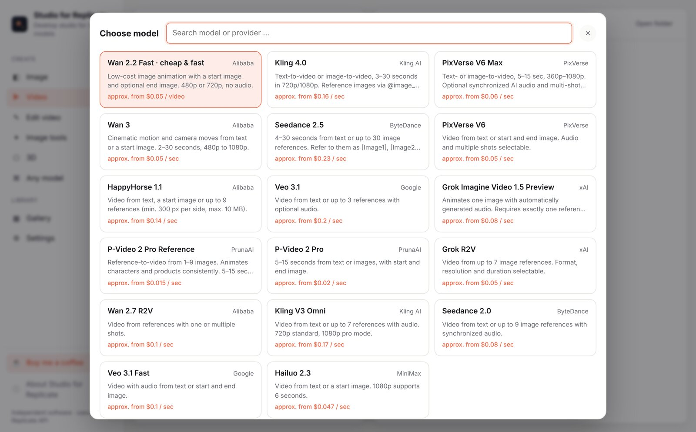

<p align="center">
  
</p>

<h1 align="center">Studio for Replicate</h1>

<p align="center">
  <strong>Desktop-Studio für KI-Bilder, -Videos und 3D – mit den Modellen auf Replicate.</strong><br>
  <em>Desktop studio for AI images, videos and 3D – powered by the models on Replicate.</em><br><br>
  macOS · Windows · Linux &nbsp;|&nbsp; Deutsch · English
</p>

<p align="center">
  <a href="https://github.com/danielwehrli/studio-for-replicate-releases/releases/latest"><strong>⬇ Neueste Version herunterladen / Download latest version</strong></a>
</p>

<p align="center">
  
</p>

---

🇩🇪 [Deutsch](#deutsch) &nbsp;·&nbsp; 🇬🇧 [English](#english)

---

## Deutsch

### Was ist Studio for Replicate?

Ein schlankes Programm für deinen Computer, mit dem du die besten KI-Modelle für Bilder, Videos und 3D nutzt, ohne Code und ohne Abo. Du gibst einen Prompt ein, wählst bei Bedarf Referenzbilder aus und klickst auf «Generieren». Die Ergebnisse werden automatisch auf deinem Computer gespeichert.

- **Bild:** Nano Banana, GPT Image, FLUX, Seedream, Imagen, Recraft, Qwen, Krea und viele mehr
- **Video:** Veo, Kling, Wan, Seedance, PixVerse, Hailuo, Grok und viele mehr
- **Video bearbeiten:** Personen ersetzen, Bewegungen übertragen, Videos per Text verändern, Videos übersetzen
- **Bildwerkzeuge:** Virtuelle Anprobe (Try-On), Hintergrund entfernen, Hochskalieren
- **3D:** 3D-Modelle (GLB) aus Text oder einem Bild
- **Beliebiges Modell:** Jedes öffentliche Modell von replicate.com lässt sich laden, das Formular entsteht automatisch.
- Referenzbilder per Klick, Drag & Drop, URL oder direkt aus deinen bisherigen Ergebnissen
- Mehrere Aufträge gleichzeitig, lokale Galerie mit Suche
- Automatische Updates

### Download

| System | Datei |
|---|---|
| **macOS** (Apple Silicon & Intel) | `Studio.for.Replicate_x.y.z_universal.dmg` |
| **Windows** 10/11 | `Studio.for.Replicate_x.y.z_x64-setup.exe` (oder `.msi`) |
| **Linux** | `.AppImage`, `.deb` oder `.rpm` |

👉 **[Zur neuesten Version](https://github.com/danielwehrli/studio-for-replicate-releases/releases/latest)**. Die Dateien findest du dort unter **«Assets»**.
Die Dateien mit der Endung `.sig` und `latest.json` sind für die automatischen Updates und müssen nicht heruntergeladen werden.

### Installation

**macOS**
1. Die `.dmg` öffnen und **Studio for Replicate** in den Ordner **Programme** ziehen.
2. Beim ersten Start meldet macOS eventuell, dass die App aus dem Internet stammt. Öffne dann **Systemeinstellungen → Datenschutz & Sicherheit**, scrolle nach unten und klicke auf **«Trotzdem öffnen»**.
3. Falls die Meldung «ist beschädigt» erscheint, im Terminal einmalig ausführen:
   ```
   xattr -cr "/Applications/Studio for Replicate.app"
   ```

**Windows**
1. Die `-setup.exe` starten.
2. Falls «Der Computer wurde durch Windows geschützt» erscheint: **Weitere Informationen → Trotzdem ausführen**.

**Linux**
- `.AppImage`: ausführbar machen (`chmod +x`) und starten, oder
- `.deb` / `.rpm` mit dem Paketmanager installieren.

### Los geht's

1. Erstelle ein kostenloses Konto auf [replicate.com](https://replicate.com) und hinterlege unter **Billing** eine Zahlungsmethode.
2. Erstelle einen **API-Token**: [replicate.com/account/api-tokens](https://replicate.com/account/api-tokens)
3. Öffne Studio for Replicate, trage den Token unter **Einstellungen** ein und klicke auf **Prüfen**.
4. Modell wählen, Prompt schreiben, **Generieren**. ✨

**Kosten:** Studio for Replicate selbst ist kostenlos. Für die Modelle bezahlst du direkt bei Replicate, nur das, was du nutzt. Die App zeigt bei jedem Modell einen ungefähren Preis an. Massgebend sind die Preise auf replicate.com.

**Datenschutz:** Dein API-Token wird nur lokal auf deinem Computer gespeichert und ausschliesslich an api.replicate.com gesendet. Es gibt keine Telemetrie und keinen eigenen Server.

### Unterstützen

Studio for Replicate ist ein Ein-Personen-Projekt. Wenn dir die App Zeit spart, freue ich mich über einen Kaffee:
☕ **[Kaffee spendieren](https://agenturwehrli.payrexx.com/)**

---

## English

### What is Studio for Replicate?

A lightweight desktop app that lets you use top AI models for images, videos and 3D, with no code and no subscription. Enter a prompt, add reference images if you like, and click "Generate". Results are saved to your computer automatically.

- **Image:** Nano Banana, GPT Image, FLUX, Seedream, Imagen, Recraft, Qwen, Krea and many more
- **Video:** Veo, Kling, Wan, Seedance, PixVerse, Hailuo, Grok and many more
- **Edit video:** replace people, transfer motion, edit videos with text, translate videos
- **Image tools:** virtual try-on, background removal, upscaling
- **3D:** 3D models (GLB) from text or an image
- **Any model:** load any public model from replicate.com; the form is generated automatically
- Reference images via file picker, drag & drop, URL or straight from your previous results
- Run several jobs at once, local gallery with search
- Automatic updates

### Download

| System | File |
|---|---|
| **macOS** (Apple Silicon & Intel) | `Studio.for.Replicate_x.y.z_universal.dmg` |
| **Windows** 10/11 | `Studio.for.Replicate_x.y.z_x64-setup.exe` (or `.msi`) |
| **Linux** | `.AppImage`, `.deb` or `.rpm` |

👉 **[Get the latest version](https://github.com/danielwehrli/studio-for-replicate-releases/releases/latest)**. The files are listed under **"Assets"**.
Files ending in `.sig` and `latest.json` are used for automatic updates and don't need to be downloaded.

### Installation

**macOS**
1. Open the `.dmg` and drag **Studio for Replicate** into **Applications**.
2. On first launch macOS may say the app was downloaded from the internet. Open **System Settings → Privacy & Security**, scroll down and click **"Open Anyway"**.
3. If you see "is damaged", run this once in Terminal:
   ```
   xattr -cr "/Applications/Studio for Replicate.app"
   ```

**Windows**
1. Run the `-setup.exe`.
2. If "Windows protected your PC" appears: **More info → Run anyway**.

**Linux**
- `.AppImage`: make it executable (`chmod +x`) and run it, or
- install the `.deb` / `.rpm` with your package manager.

### Getting started

1. Create a free account on [replicate.com](https://replicate.com) and add a payment method under **Billing**.
2. Create an **API token**: [replicate.com/account/api-tokens](https://replicate.com/account/api-tokens)
3. Open Studio for Replicate, paste the token under **Settings** and click **Verify**.
4. Pick a model, write a prompt, hit **Generate**. ✨

**Cost:** Studio for Replicate itself is free. You pay Replicate directly for the models, only for what you use. The app shows an approximate price for each model. The prices on replicate.com are authoritative.

**Privacy:** Your API token is stored only on your computer and is sent exclusively to api.replicate.com. There is no telemetry and no server of our own.

### Support

Studio for Replicate is a one-person project. If it saves you time, a coffee is much appreciated:
☕ **[Buy me a coffee](https://agenturwehrli.payrexx.com/)**

---

## Rechtliches / Legal

**Studio for Replicate** wird entwickelt von **Daniel Wehrli | [agenturwehrli.ch](https://agenturwehrli.ch)**.

Studio for Replicate ist ein unabhängiges Produkt und **kein offizielles Produkt der Replicate, Inc.** Es wird von Replicate weder betrieben, gesponsert, geprüft noch unterstützt. Die KI-Modelle laufen auf der Plattform von Replicate. Die App nutzt dazu die öffentliche Replicate-API mit deinem eigenen API-Token. «Replicate» ist eine Marke der Replicate, Inc. und wird hier nur beschreibend verwendet. Alle Modellnamen und Marken gehören ihren jeweiligen Inhabern.

*Studio for Replicate is an independent product and **not an official product of Replicate, Inc.** It is not operated, sponsored, reviewed or endorsed by Replicate. The AI models run on Replicate's platform via the public Replicate API using your own API token. "Replicate" is a trademark of Replicate, Inc. and is used descriptively only. All model names and trademarks belong to their respective owners.*

© 2026 Daniel Wehrli | agenturwehrli.ch. Alle Rechte vorbehalten. / All rights reserved.
